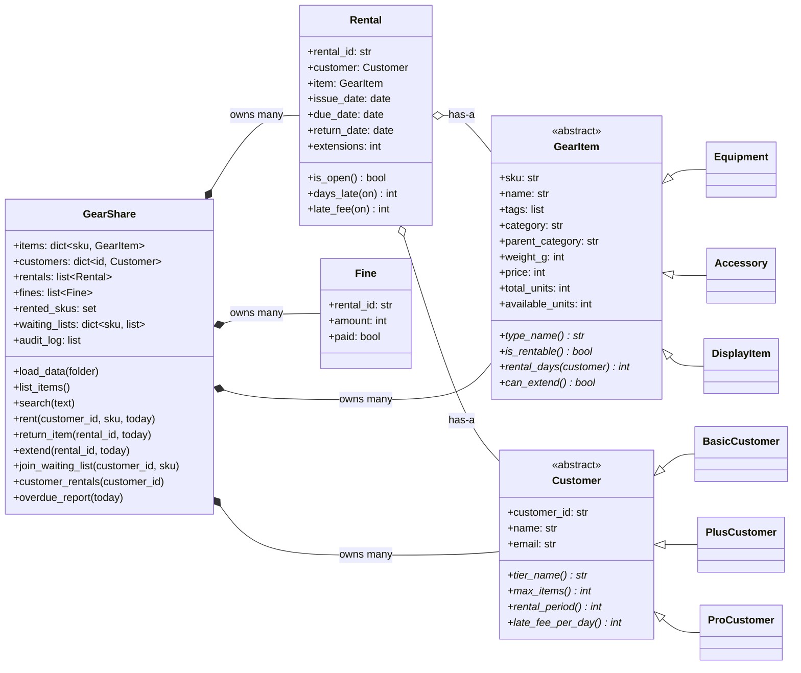

# Phase 1 Design: Class Diagram and CRC Cards

I did this design before writing any Phase 1 code. Later phases added to it:
Phase 2 added indexes and the undo stack inside `GearShare`, and Phase 3 added
the `storage/` layer underneath it. The classes and their relationships below
haven't changed.

## 1. Nouns and verbs from the Rulebook

I went through the Rulebook and the order of checks, and pulled out the nouns
(possible classes) and verbs (possible methods):

| Nouns (candidate classes)                | Verbs (candidate methods)                       |
|------------------------------------------|-------------------------------------------------|
| item / equipment / accessory / display   | rent, return, extend                            |
| customer / tier (Basic, Plus, Pro)       | join (waiting list), serve (first in list)      |
| rental, due date, extension              | calculate (late fee), cap (at price)            |
| fine, waiting list, SKU                  | check (limit, fines, duplicate, availability)   |
| shop (the service)                       | list, search, report (overdue)                  |

Not every noun deserved its own class. "SKU", "due date" and "waiting list"
ended up as attributes. A tier is fully described by three numbers, so instead
of a separate Tier class, each tier became a `Customer` subclass.

## 2. Class diagram

## 3. Inheritance or composition?

One sentence to defend each relationship:

| Relationship | Kind | Why |
|---|---|---|
| Equipment / Accessory / DisplayItem → GearItem | is-a (inheritance) | They're all gear with a SKU, name and price; they only differ in whether they can be rented, for how long, and whether they can be extended. |
| Basic / Plus / ProCustomer → Customer | is-a (inheritance) | They're all customers with an ID, name and email; only the three tier numbers differ. |
| Rental → Customer, Rental → GearItem | has-a (composition) | A rental isn't a kind of customer or item; it links one customer to one item for a while. |
| GearShare → items, customers, rentals, fines | has-a (composition) | The shop holds the collections and applies rules across them; it isn't an item or a customer itself. |
| Fine → Rental (by `rental_id`) | has-a (reference) | A fine belongs to exactly one rental, but most rentals have no fine, so it's a separate record. |

## 4. What each abstract class makes its subclasses answer

Every item type has to answer the same four questions, each in its own way:

| Question                 | Equipment                  | Accessory        | DisplayItem  |
|--------------------------|----------------------------|------------------|--------------|
| `type_name()`            | `Equipment`                | `Accessory`      | `Display`    |
| `is_rentable()` (R1)     | True                       | True             | **False**    |
| `rental_days(customer)`  | `customer.rental_period()` | **2** (R2)       | 0 (never rented) |
| `can_extend()` (R2)      | True                       | **False**        | False        |

And every tier answers three:

| Question               | Basic | Plus | Pro |
|------------------------|-------|------|-----|
| `max_items()` (R3)     | 2     | 4    | 8   |
| `rental_period()`      | 3     | 5    | 7   |
| `late_fee_per_day()` (R5) | 50 | 100  | 150 |

So the answer to "where does that knowledge live?" is: "a display item can't be
rented" lives in `DisplayItem`, and "a Basic customer gets 3 days" lives in
`BasicCustomer`. `GearShare` never asks what tier or type an object is; it just
calls these methods. That's why there's no `if tier == ...` anywhere in the code.

## 5. CRC cards

One card per class: what it's responsible for, and who it works with.

| **GearItem** (abstract) | |
|---|---|
| **Responsibilities** | Validate its own SKU (R9), name, units; track available units; say whether it is rentable (R1), for how long (R2) and whether it can be extended (R2) |
| **Collaborators** | Customer (asks its rental period) |

| **Customer** (abstract) | |
|---|---|
| **Responsibilities** | Validate its own id, name, email; know its tier's item limit (R3), rental period and daily late fee (R5) |
| **Collaborators** | — |

| **Rental** | |
|---|---|
| **Responsibilities** | Remember who rented what and when; count extensions (R6); compute days late (R10) and the late fee capped at the item price (R5) |
| **Collaborators** | Customer (late fee per day), GearItem (price) |

| **Fine** | |
|---|---|
| **Responsibilities** | Record the amount charged for one rental and whether it is paid (R4) |
| **Collaborators** | Rental (by id) |

| **GearShare** (service) | |
|---|---|
| **Responsibilities** | Load data; run the order of checks for renting (R1, R3, R4, R7, R8, R9); return, extend (R6), waiting list (R7); reports; audit log |
| **Collaborators** | GearItem, Customer, Rental, Fine, errors |
