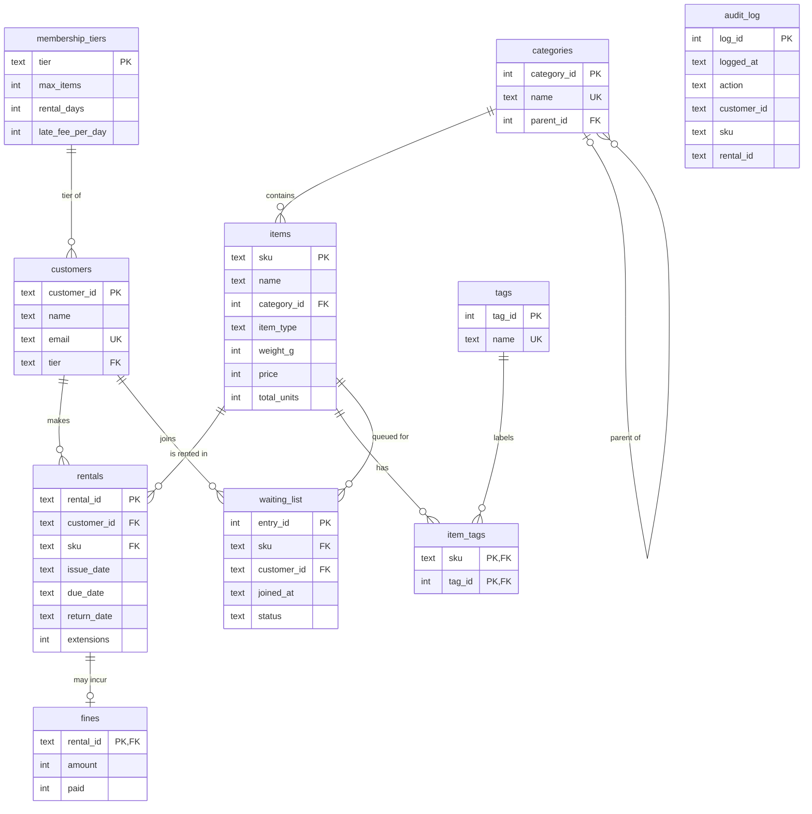

# Phase 3: ER Diagram

## How to view it in dbdiagram.io

1. Open <https://dbdiagram.io/d> and paste the DBML code below into the left panel.
2. Export: **Export → PNG**, then save it as `docs/er_diagram.png`.

In DBML, `>` means **many-to-one** (many rows here, one row there), and `-`
means **one-to-one**. The Mermaid diagram further down shows the same model,
and renders on GitHub and in VS Code's Markdown preview.

```dbml
Table membership_tiers {
  tier varchar [pk]
  max_items int [not null, note: 'R3']
  rental_days int [not null]
  late_fee_per_day int [not null, note: 'R5']
}

Table customers {
  customer_id varchar [pk]
  name varchar [not null]
  email varchar [not null, unique]
  tier varchar [not null, ref: > membership_tiers.tier]   // many customers : 1 tier
}

Table categories {
  category_id int [pk]
  name varchar [not null, unique]
  parent_id int [ref: > categories.category_id, note: 'NULL = top level']  // self-reference
}

Table items {
  sku varchar(10) [pk, note: 'exactly 10 digits (R9)']
  name varchar [not null]
  category_id int [not null, ref: > categories.category_id]  // many items : 1 category
  item_type varchar [not null, note: 'Equipment | Accessory | Display']
  weight_g int [not null]
  price int [not null]
  total_units int [not null]
}

Table tags {
  tag_id int [pk]
  name varchar [not null, unique]
}

Table item_tags {
  sku varchar(10) [ref: > items.sku]      // junction: many-to-many items <-> tags
  tag_id int [ref: > tags.tag_id]
  indexes { (sku, tag_id) [pk] }
}

Table rentals {
  rental_id varchar [pk]
  customer_id varchar [not null, ref: > customers.customer_id]  // many rentals : 1 customer
  sku varchar(10) [not null, ref: > items.sku]                   // many rentals : 1 item
  issue_date date [not null]
  due_date date [not null, note: '>= issue_date']
  return_date date [note: 'NULL = still on rental']
  extensions int [not null, default: 0, note: '0..2 (R6)']
}

Table fines {
  rental_id varchar [pk, ref: - rentals.rental_id]   // 1 rental : 0..1 fine
  amount int [not null, note: '>= 0']
  paid boolean [not null, default: false]
}

Table waiting_list {
  entry_id int [pk, increment]
  sku varchar(10) [not null, ref: > items.sku]
  customer_id varchar [not null, ref: > customers.customer_id]
  joined_at timestamp [not null]
  status varchar [not null, note: 'waiting | reserved']
  indexes { (sku, customer_id) [unique] }
}

Table audit_log {
  log_id int [pk, increment]
  logged_at timestamp [not null]
  action varchar [not null]
  customer_id varchar [not null, note: 'no FK on purpose: history outlives rows']
  sku varchar [not null]
  rental_id varchar [not null]
}
```

## Mermaid version



## Cardinality of every relationship

| Relationship | Cardinality | Read it as |
|---|---|---|
| membership_tiers → customers | 1 : 0..many | A tier has any number of customers; each customer has exactly one tier. |
| customers → rentals | 1 : 0..many | Pooja has 0 rentals, Vikram has 3; each rental belongs to exactly one customer. |
| items → rentals | 1 : 0..many | The Leica has 0 rentals, the Canon has 3; each rental is for exactly one item. |
| rentals → fines | 1 : 0..1 | A rental has at most one fine (6 of 10 have none); each fine is for exactly one rental. |
| categories → items | 1 : 0..many | Photography itself holds no items directly; each item is in exactly one category. |
| categories → categories | 0..1 parent : 0..many children | Photography is the parent of Cameras and Lenses; top-level categories have no parent. |
| items ↔ tags (via item_tags) | many : many | The Canon has 2 tags; `photo` is on 2 items. |
| items → waiting_list | 1 : 0..many | Each queue entry is for one item. |
| customers → waiting_list | 1 : 0..many | A customer can wait for several items, but only once per item (UNIQUE). |
| audit_log | none (on purpose) | Stores IDs as plain text, so the history survives even when the rental row is gone. |
